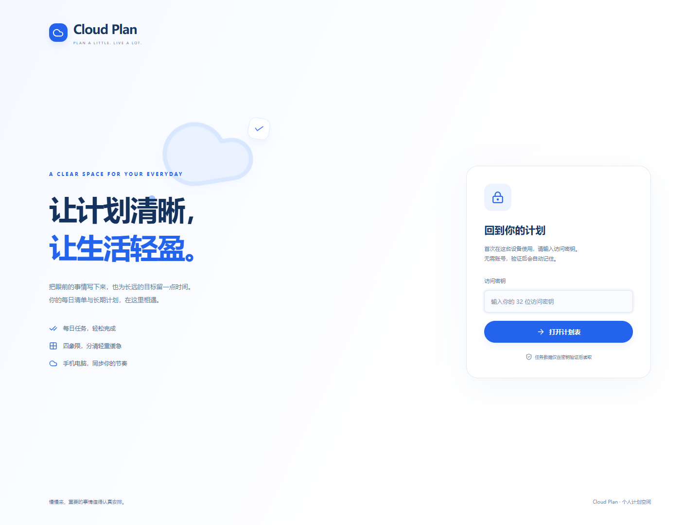
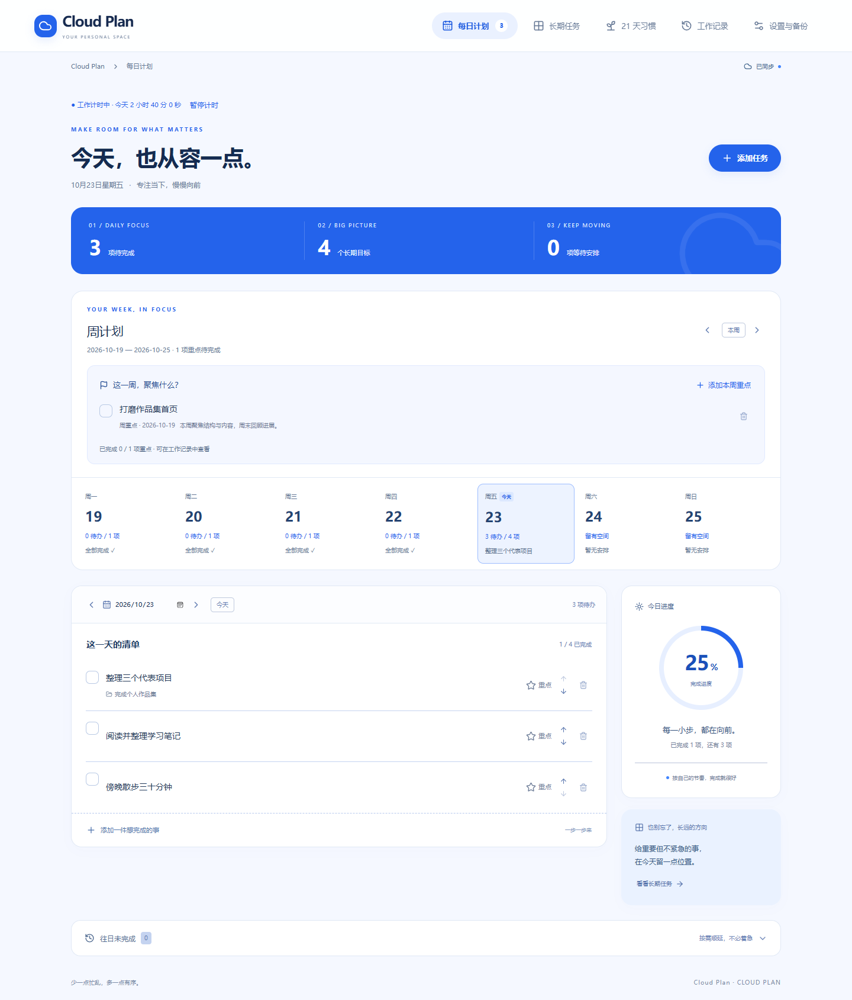
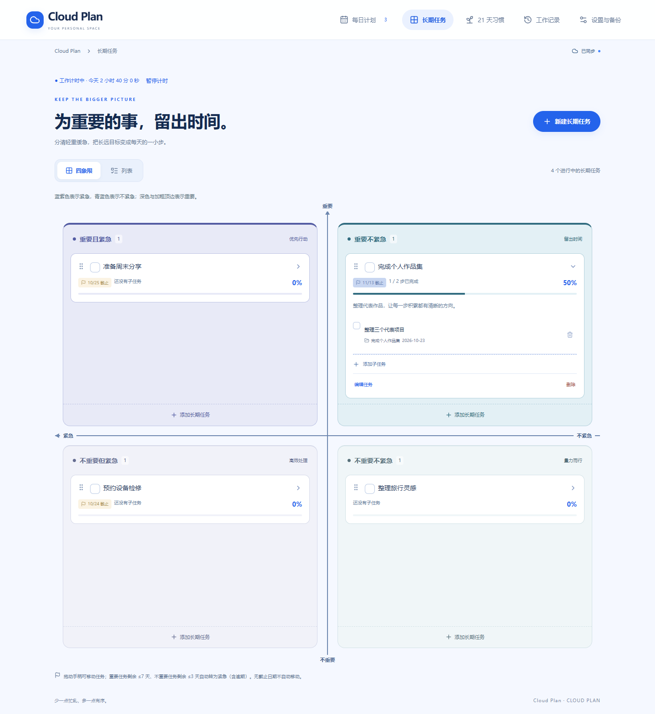
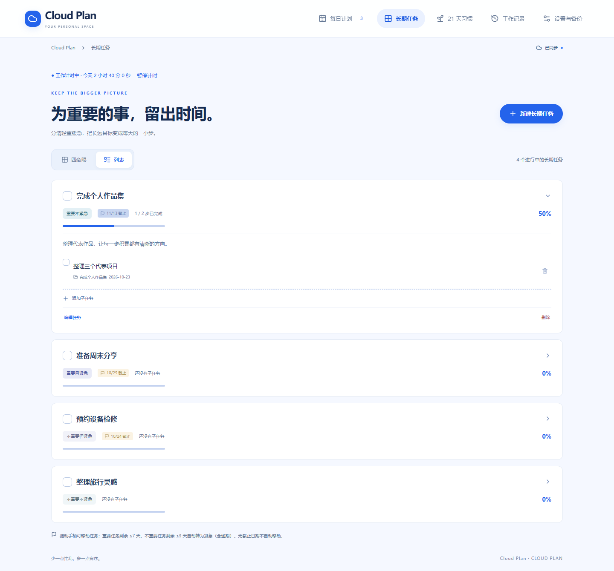
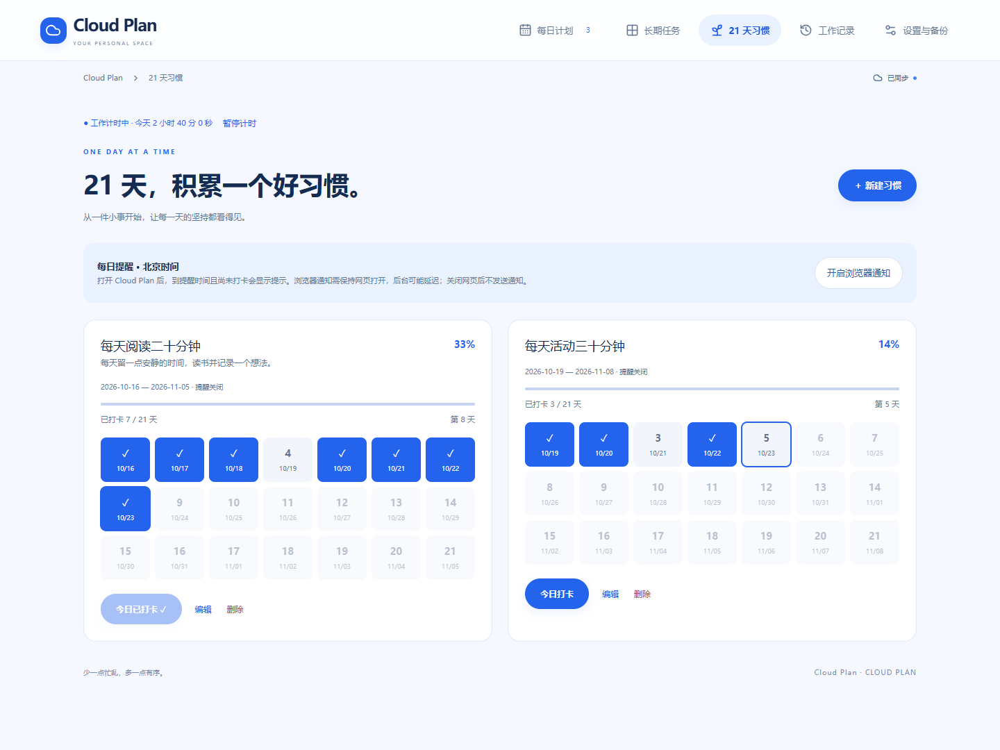
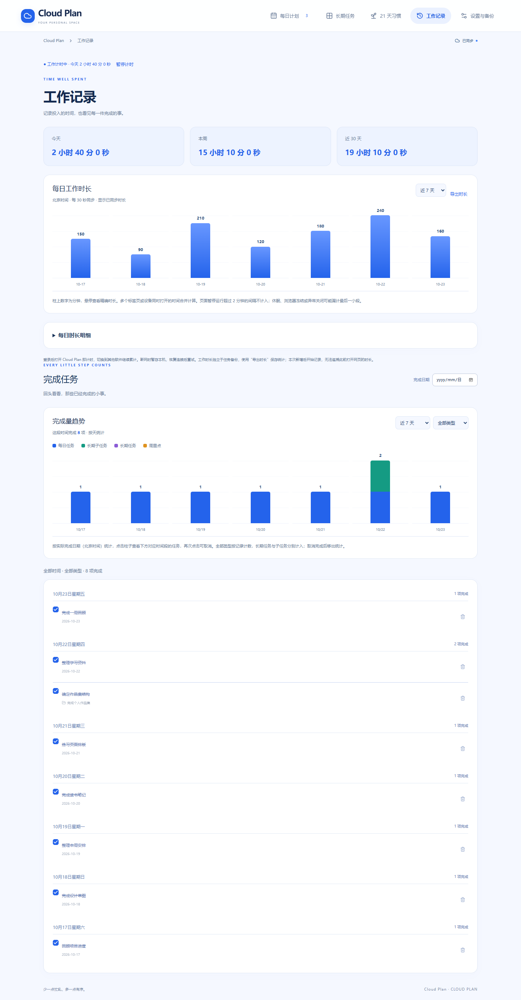
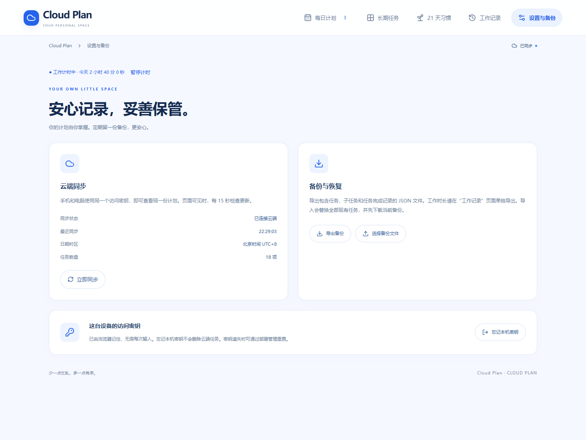
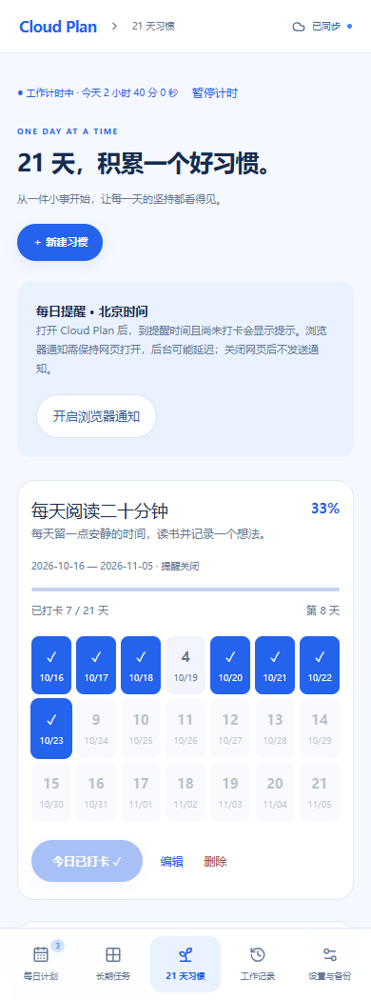

# Cloud Plan · 个人计划空间

**让计划清晰，让生活轻盈。**

Cloud Plan 是一款中文个人计划工具，将每日清单、周重点、长期目标、习惯打卡和工作记录放在同一个空间里。从安排今天要做的事，到回顾一段时间的投入与成果，手机和电脑都可以接续使用。

无需注册账号，在设备上输入访问密钥即可打开计划表，浏览器会记住密钥。使用同一个密钥的设备共享同一份云端计划。



> 以下为当前界面的演示数据截图，不包含真实个人计划或访问密钥。点击图片可查看大图。

## 界面一览

界面以白色和浅蓝色为底，蓝色突出主要操作，配合圆角卡片、进度条和图表呈现计划。桌面端通过导航栏切换页面，手机端使用底部导航；每日清单、目标卡片和统计图会随屏幕尺寸调整布局。

| 页面 / 区域 | 你可以看到和完成什么 |
| --- | --- |
| 每日计划 | 本周重点、七天概览、当天待办、完成进度和往日未完成事项 |
| 长期任务 | 四象限与列表视图、目标截止日期、子任务和进度 |
| 21 天习惯 | 习惯卡片、21 天打卡格、练习进度和每日提醒 |
| 工作记录 | 今日、本周、近 30 天工作时长，以及完成量趋势与完成记录 |
| 设置与备份 | 导出与恢复计划数据、管理当前设备记住的访问密钥 |

## 每日计划：把今天安排清楚



每日计划：上方查看本周重点和七天概览，下方操作当日清单，右侧查看完成进度。

选择日期即可查看当天清单，新增任务、点击标题编辑，或勾选完成。任务支持备注、计划日期和截止日期，可以用上下箭头调整顺序。

- **当日进度**：通过概览与进度环查看当天的完成情况。
- **目标联动**：长期目标的子任务设置计划日期后，会出现在对应日期的清单里。
- **往日待办**：展开未完成事项，按需逐条或批量顺延，避免遗漏。
- **即时操作反馈**：新增与排序立即显示，后台保存状态帮助确认是否已同步。

计划日期表示准备在哪天做，截止日期表示最晚何时完成，两者可以分别设置。完成事项会移出待办列表，并进入完成记录。

## 周计划：先确定这一周的重点

每日计划上方提供周计划区域，以北京时间的周一至周日为一周。

可以切换周次，新增、编辑、删除和完成本周重点；七天概览显示各日待办数量，点击某一天即可切换下方清单。周重点独立于每日任务，适合记录“本周完成报告初稿”这类阶段性成果，完成后同样可以在记录中回顾。

未完成重点会保留在所属周，不会自动顺延到下一周。

## 长期任务：分清轻重缓急，逐步推进目标



四象限：以重要与紧急程度定位目标，展开卡片查看子任务与进度。

长期任务提供两种视图，切换时保留同一份目标和进度：

- **四象限视图**：按重要程度和紧急程度排列成 2×2 网格，向上更重要、向左更紧急。拖动目标手柄即可调整分类，也可以在编辑窗口中选择象限。
- **列表视图**：集中查看进行中的目标、分类标签、截止日期和子任务进度。

<details>
<summary>查看长期任务列表视图</summary>



列表视图将目标纵向排列，适合逐项查看分类、截止日期和完成比例。

</details>

展开目标卡片即可管理一层子任务。进度条显示已完成步数与比例，帮助看清大目标推进到了哪里；长期目标本身需要手动标记完成。

设置截止日期后，未完成目标会在临近期限时自动进入紧急象限：重要目标为剩余不超过 7 天，不重要目标为剩余不超过 3 天，均包含截止当天和逾期。延后或清空截止日期后，可以手动移回非紧急分类。

## 21 天习惯：让每天的坚持看得见



习惯卡片：蓝色日期表示已打卡，边框标出今天，进度条记录练习的积累。

为阅读、运动等小习惯创建一张卡片，填写行动说明、开始日期和可选的每日提醒时间。

每张卡片展示 **21 个自然日的打卡格、已完成天数和百分比进度**。当天可以一键打卡，也可以补打过去日期或撤销记录；未来日期不能提前打卡，有记录后开始日期固定。

到提醒时间仍未打卡时，页面会显示提示。还可以主动开启本机浏览器通知，但需要保持网页打开，后台通知可能延迟。21 天是练习周期，不代表每个人都能在这段时间内自动养成习惯。

## 工作记录：回顾时间投入与完成成果



工作记录：上方汇总投入时长，下方用分类柱状图和完成清单回顾成果。

### 工作时长

进入计划空间后，网页保持运行即开始计时，切到其他软件时仍可累计，也可随时暂停和恢复。

- **汇总卡片**：查看今天、本周和近 30 天的累计时长。
- **每日柱状图**：切换近 7 天或近 30 天，悬停查看精确时长。
- **每日明细**：展开逐日记录，或使用“导出时长”单独保存统计。

多个标签页或设备的重叠时间会合并计算。计时每 30 秒同步，断网片段暂存在本机并在恢复连接后重试。这里记录的是网页运行时间；休眠、冻结超过 2 分钟的间隔不计入，异常退出可能漏计最后一小段。

### 完成量趋势与记录

通过彩色堆叠柱状图查看近 7 天、近 30 天或近 12 个月的完成量，也可按每日任务、长期子任务、长期任务和周重点筛选。

点击柱子即可查看对应日期或月份的完成事项，再次点击取消筛选。记录按实际完成时间（北京时间）归档，支持取消完成；长期任务与子任务分别计数，习惯打卡不混入任务完成量。

## 云端同步与备份



设置与备份：查看同步状态，导出或恢复数据，并管理本机记住的密钥。

页面可见时每 15 秒检查更新，重新聚焦时也会刷新。在电脑上安排计划后，可以在手机上继续查看和操作。

“设置与备份”支持导出 JSON，保存任务、周重点、习惯及打卡记录。恢复前会校验文件并显示数据数量，确认后先下载当前数据备份，再替换云端数据。**工作时长独立保存，需要在工作记录页面单独导出。**

保存期间会显示同步状态；失败时提供重试入口，发生版本冲突时可加载最新数据并保留草稿。计划编辑不支持完整离线使用，看到“尚未保存”时请先处理提示，再关闭页面。

## 手机界面

手机上通过底部导航切换页面，习惯卡片纵向排列；打卡格和主要按钮保持清晰可点。



## 开始使用

1. 在电脑或手机打开已部署的 Cloud Plan，输入访问密钥。
2. 写下本周重点，再把今天要做的事加入每日清单。
3. 将长期目标放入四象限，拆成子任务并安排到具体日期。
4. 为想坚持的小事创建习惯卡，每天打卡。
5. 在工作记录中回顾投入与成果，并定期导出备份。

Cloud Plan 面向个人使用。访问密钥可读取和修改计划，请妥善保存；备份文件也包含个人计划内容。

## 开发与部署

技术栈：React / Vinext、TypeScript、Cloudflare D1，使用 Sites 托管。

<details>
<summary>展开本地运行、验证与部署说明</summary>

文档截图可在启动本地 5173 端口预览后运行 `node scripts/readme-screenshots.mjs` 重新生成。脚本使用独立无头 Edge 和浏览器内演示数据拦截，不读写计划数据库。

## 项目与运行

- Node.js >= 22.13，Vinext / React，Cloudflare D1，Sites 托管。
- `.openai/hosting.json` 保存当前 Site ID 和数据库绑定；复用此身份，勿重复创建 Site。
- `app/page.tsx`、`app/globals.css` 是交互界面与响应式样式。
- `lib/planner.ts` 定义任务和备份校验、操作语义；`lib/api.ts` 实现密钥验证和乐观并发控制。
- `app/api/planner/route.ts` 将操作保存到 D1。所有 API 访问都验证 `X-Planner-Key`，拒绝缓存。
- 单用户任务快照和递增版本号保存在一个 D1 记录内，批量操作采用带版本条件的原子 UPSERT。记录上限 1.5 MB，最多 10000 条任务。

```powershell
npm run install:ci
node scripts/create-access-key.mjs
npm run db:generate # 仅在变更 schema 后生成新迁移；已有迁移不能重写
npm run build
$env:CLOUDFLARE_CF_FETCH_ENABLED = 'false'
node --import ./scripts/sites-env.mjs ./node_modules/wrangler/bin/wrangler.js d1 execute DB --local --config dist/server/wrangler.json --persist-to .wrangler/state --file drizzle/0000_complete_vanisher.sql
npm run dev -- --port 5173
```

已有本地数据库不要重复执行已应用的迁移。本地模拟数据和生产数据彼此独立。

首次生成的密钥在忽略版本控制的 `outputs/access-key.txt`；本地校验值在 `.dev.vars`。已有密钥时脚本会拒绝覆盖。密钥和 `.dev.vars` 均不得提交或打包。Windows 上若 npm 命令转发失败，可使用 `node "C:\Program Files\nodejs\node_modules\npm\bin\npm-cli.js"` 代替 `npm`。

## 验证

```powershell
npm run typecheck
npm test
npm run test:browser
```

浏览器测试使用独立的无头 Edge 会话，需要本机安装 Edge 和已启动的 5173 端口预览。仅允许 localhost / 127.0.0.1 地址；测试会替换本地模拟数据库数据，不应对正式数据运行。截图和结果保存在忽略的 `tests/output/`。可通过 `PLANNER_TEST_URL` 指定另一本地地址。

## 部署与密钥重置

发布使用 Sites 技能的源码同步、打包、保存版本和部署流程。网站入口需要 public 访问模式，任务 API 仍由应用密钥保护。生产环境设置 secret 类型的 `PLANNER_KEY_HASH`（访问密钥的 SHA-256 十六进制值），不可设置明文密钥或把它写入代码。首次部署自动应用 Drizzle SQL 迁移。

重置密钥步骤：

1. 在项目目录执行 `node scripts/create-access-key.mjs --rotate`，生成新密钥及本地校验值。
2. 通过 Sites 部署管理将 secret `PLANNER_KEY_HASH` 更新为 `.dev.vars` 中的新校验值。
3. 重新部署已保存的版本，让环境配置生效。无需清空或迁移任务数据。
4. 在各设备忘记旧密钥并输入新密钥。旧密钥将无法读取或修改数据。

</details>
